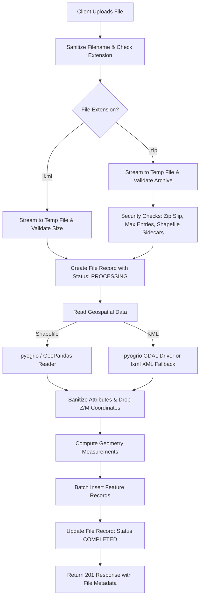

# Geospatial File Measurement Backend API

A production-quality, local-independent backend service built with **FastAPI** that accepts geospatial files (zipped Shapefiles and KML), extracts feature geometries and attributes, transforms geographic coordinates into local projected coordinate systems, and calculates high-precision geometric measurements (polygon area and line length).

---

## Table of Contents
1. [Overview & Problem Statement](#overview--problem-statement)
2. [Local Setup & Quickstart](#local-setup--quickstart)
3. [API Documentation & Examples](#api-documentation--examples)
   - [1. Upload Geospatial File](#1-upload-geospatial-file)
   - [2. Get File Information](#2-get-file-information)
   - [3. Get Feature Measurements](#3-get-feature-measurements)
   - [4. List Uploaded Files](#4-list-uploaded-files)
   - [5. Get Raw Features](#5-get-raw-features)
   - [6. Delete File](#6-delete-file)
   - [7. Health Check](#7-health-check)
4. [Architecture & Implementation Details](#architecture--implementation-details)
   - [Application Structure](#application-structure)
   - [File-Processing Flow](#file-processing-flow)
   - [Measurement Calculation Flow](#measurement-calculation-flow)
   - [CRS Handling & Projection Strategy](#crs-handling--projection-strategy)
5. [Design Decisions & Alternatives Considered](#design-decisions--alternatives-considered)
6. [Testing](#testing)
7. [Learnings & Future Scope](#learnings--future-scope)

---

## Overview & Problem Statement

Geospatial data formats such as Shapefiles and KML frequently encode geometries using geographic coordinates (latitude and longitude in degrees, e.g., `EPSG:4326`). Calculating distances or areas directly on degree coordinates produces physically meaningless values because degrees do not have constant lengths over the curved surface of the Earth.

This service:
- Accepts `.kml` files and `.zip` archives containing ESRI Shapefiles (`.shp`, `.shx`, `.dbf`, `.prj`).
- Robustly parses features, geometries, coordinate reference systems (CRS), and metadata attributes.
- Gracefully handles unsupported geometries (Points, GeometryCollections, empty geometries) without crashing.
- Dynamically selects an appropriate projected coordinate system (UTM zone, Equal-Area, or Geodesic) based on the geometry's coordinates.
- Computes planar metric measurements (Polygon Area in $\text{m}^2$, LineString Length in $\text{m}$).
- Works **100% locally and independently** using SQLite or in-memory storage, without requiring external database servers or cloud dependencies.

---

## Local Setup & Quickstart

### Prerequisites
- Python 3.10+ (tested on Python 3.11, 3.12, 3.13)
- `pip` or `uv` package manager

### 1. Installation

Clone the repository and navigate into the `backend` directory:
```bash
cd backend
```

Create and activate a virtual environment:
```bash
# Windows
python -m venv .venv
.venv\Scripts\activate

# macOS / Linux
python3 -m venv .venv
source .venv/bin/activate
```

Install dependencies:
```bash
pip install -r requirements.txt
```
*(Or if using `uv`: `uv pip install -r requirements.txt`)*

### 2. Configuration (Optional)

The application works out-of-the-box with zero configuration using local SQLite. You can optionally customize settings via environment variables or a `.env` file:

```bash
cp .env.example .env
```

Default variables:
```env
DB_BACKEND=sqlite                   # "sqlite" (default local), "memory", or "mongodb"
SQLITE_DB_PATH=data/geo_measurement.db
MAX_UPLOAD_MB=50
MAX_UNZIPPED_MB=500
MAX_ZIP_ENTRIES=100
MAX_FEATURES_PER_FILE=50000
HOST=127.0.0.1
PORT=8000
```

### 3. Running the Server

Start the API server:
```bash
python run.py
```
Or directly with Uvicorn:
```bash
uvicorn app.main:app --host 127.0.0.1 --port 8000 --reload
```

- **Interactive API Documentation (Swagger UI)**: [http://127.0.0.1:8000/docs](http://127.0.0.1:8000/docs)
- **ReDoc Documentation**: [http://127.0.0.1:8000/redoc](http://127.0.0.1:8000/redoc)
- **OpenAPI Schema**: [http://127.0.0.1:8000/api/openapi.json](http://127.0.0.1:8000/api/openapi.json)

---

## API Documentation & Examples

### 1. Upload Geospatial File
Accepts a `.kml` file or a `.zip` archive containing a Shapefile. Validates, extracts features, calculates projected measurements, and stores records.

- **Method**: `POST`
- **Endpoint**: `/api/files/`
- **Content-Type**: `multipart/form-data`
- **Request Body**: `file`: Binary file (`.kml` or `.zip`)

#### Example cURL:
```bash
curl -X POST "http://127.0.0.1:8000/api/files/" \
  -F "file=@samples/sample.kml"
```

#### Example Response (`201 Created`):
```json
{
  "id": "e4f3a7638d91456a935515b6d61f1c01",
  "filename": "sample.kml",
  "file_type": "kml",
  "feature_count": 3,
  "crs": "EPSG:4326",
  "status": "COMPLETED",
  "warnings": [
    "Z/M coordinates were dropped; measurements use 2D geometry."
  ],
  "error_message": null,
  "geometry_type_counts": {
    "Point": 1,
    "Polygon": 1,
    "LineString": 1
  },
  "created_at": "2026-10-09T16:00:00.123456+00:00",
  "completed_at": "2026-10-09T16:00:00.345678+00:00"
}
```

---

### 2. Get File Information
Returns public metadata and processing status for an uploaded file.

- **Method**: `GET`
- **Endpoint**: `/api/files/{id}/`

#### Example cURL:
```bash
curl -X GET "http://127.0.0.1:8000/api/files/e4f3a7638d91456a935515b6d61f1c01/"
```

#### Example Response (`200 OK`):
```json
{
  "id": "e4f3a7638d91456a935515b6d61f1c01",
  "filename": "sample.kml",
  "file_type": "kml",
  "feature_count": 3,
  "crs": "EPSG:4326",
  "status": "COMPLETED",
  "warnings": [
    "Z/M coordinates were dropped; measurements use 2D geometry."
  ],
  "error_message": null,
  "geometry_type_counts": {
    "Point": 1,
    "Polygon": 1,
    "LineString": 1
  },
  "created_at": "2026-10-09T16:00:00.123456+00:00",
  "completed_at": "2026-10-09T16:00:00.345678+00:00"
}
```

---

### 3. Get Feature Measurements
Returns calculated measurements (area in $\text{m}^2$, length in meters) along with aggregate summaries for the entire file.

- **Method**: `GET`
- **Endpoint**: `/api/files/{id}/measurements/`
- **Query Parameters**:
  - `limit` (default: 100, min: 1, max: 1000)
  - `offset` (default: 0)
  - `geometry_type` (optional filter, e.g. `Polygon`, `LineString`)

#### Example cURL:
```bash
curl -X GET "http://127.0.0.1:8000/api/files/e4f3a7638d91456a935515b6d61f1c01/measurements/?geometry_type=Polygon"
```

#### Example Response (`200 OK`):
```json
{
  "file_id": "e4f3a7638d91456a935515b6d61f1c01",
  "status": "COMPLETED",
  "crs": "EPSG:4326",
  "feature_count": 3,
  "summary": {
    "total_area_sq_m": 7780.24,
    "total_length_m": 140.75,
    "counts_by_geometry_type": {
      "Point": 1,
      "Polygon": 1,
      "LineString": 1
    },
    "counts_by_measurement_status": {
      "NOT_APPLICABLE": 1,
      "CALCULATED": 2
    }
  },
  "pagination": {
    "limit": 100,
    "offset": 0,
    "returned": 1
  },
  "filtered_total": 1,
  "features": [
    {
      "feature_index": 1,
      "layer": null,
      "geometry_type": "Polygon",
      "measurement_status": "CALCULATED",
      "measurements": {
        "area_sq_m": 7780.24,
        "area_hectares": 0.778,
        "area_sq_km": 0.0078
      },
      "projected_crs": "EPSG:32610",
      "method": "utm_projected",
      "note": null
    }
  ]
}
```

---

### 4. List Uploaded Files
Returns paginated upload history, sorted newest first.

- **Method**: `GET`
- **Endpoint**: `/api/files/`
- **Query Parameters**: `limit` (default: 100), `offset` (default: 0)

#### Example Response (`200 OK`):
```json
{
  "total": 1,
  "limit": 100,
  "offset": 0,
  "files": [
    {
      "id": "e4f3a7638d91456a935515b6d61f1c01",
      "filename": "sample.kml",
      "file_type": "kml",
      "feature_count": 3,
      "crs": "EPSG:4326",
      "status": "COMPLETED",
      "warnings": [],
      "error_message": null,
      "geometry_type_counts": {
        "Point": 1,
        "Polygon": 1,
        "LineString": 1
      },
      "created_at": "2026-10-09T16:00:00.123456+00:00",
      "completed_at": "2026-10-09T16:00:00.345678+00:00"
    }
  ]
}
```

---

### 5. Get Raw Features
Returns paginated raw feature geometries (GeoJSON format) and metadata properties extracted from the file.

- **Method**: `GET`
- **Endpoint**: `/api/files/{id}/features/`

#### Example Response (`200 OK`):
```json
{
  "file_id": "e4f3a7638d91456a935515b6d61f1c01",
  "limit": 100,
  "offset": 0,
  "total": 3,
  "features": [
    {
      "feature_index": 0,
      "geometry_type": "Point",
      "geometry": {
        "type": "Point",
        "coordinates": [-122.4194, 37.7749]
      },
      "crs": "EPSG:4326",
      "properties": {
        "name": "Survey marker"
      }
    }
  ]
}
```

---

### 6. Delete File
Deletes file metadata, stored features, and measurements.

- **Method**: `DELETE`
- **Endpoint**: `/api/files/{id}/`
- **Response**: `204 No Content`

---

### 7. Health Check
Verifies service availability and database connectivity.

- **Method**: `GET`
- **Endpoint**: `/api/health` (or `/health`, `/healthz`)

#### Example Response (`200 OK`):
```json
{
  "status": "ok",
  "backend": "sqlite"
}
```

---

## Architecture & Implementation Details

### Application Structure
```text
backend/
├── app/
│   ├── api/
│   │   ├── dependencies.py          # Dependency injection for repository & settings
│   │   └── routes/
│   │       ├── files.py             # File upload, query, measurements, delete routes
│   │       └── health.py            # Storage-agnostic health checks
│   ├── core/
│   │   ├── config.py                # Pydantic Settings with SQLite local default
│   │   └── errors.py                # Domain exceptions and error envelope
│   ├── db/
│   │   ├── sqlite.py                # SQLite connection manager, WAL mode, tables
│   │   └── mongo.py                 # Optional MongoDB client
│   ├── repositories/
│   │   ├── base.py                  # Abstract FileRepository interface
│   │   ├── sqlite_repository.py     # High-performance local SQLite storage
│   │   ├── memory_repository.py     # In-memory storage for unit tests
│   │   └── mongo_repository.py      # Optional MongoDB storage
│   ├── schemas/
│   │   └── files.py                 # Pydantic response and serialization schemas
│   ├── services/
│   │   ├── crs.py                   # CRS normalization and projected CRS selection
│   │   ├── file_service.py          # Upload orchestration and transaction handling
│   │   ├── geo_reader.py            # Shapefile and KML parsing with lxml fallback
│   │   ├── measurement.py           # Pure geometric measurement calculations
│   │   └── upload_validation.py     # Stream size bounds and archive security checks
│   ├── main.py                      # FastAPI application factory and error handlers
│   └── models.py                    # Internal FeatureRecord dataclass
├── samples/                         # Sample datasets and generator
│   ├── generate_samples.py
│   ├── sample.kml
│   └── sample_shapefile.zip
├── tests/                           # Comprehensive test suite (34 tests)
│   ├── conftest.py
│   ├── test_api.py
│   ├── test_kml_reader.py
│   ├── test_measurement.py
│   ├── test_properties.py
│   ├── test_sqlite_api.py
│   ├── test_sqlite_repository.py
│   └── test_upload_validation.py
├── pyproject.toml
├── requirements.txt
├── run.py                           # Convenient server launcher
└── README.md
```

### File-Processing Flow


### Measurement Calculation Flow
1. **Geometry Validation & Repair**:
   - Polygons are inspected for validity. If invalid (e.g. self-intersecting bow-tie), `shapely.make_valid` repairs the rings while preserving polygonal parts.
2. **Dimension Flattening**:
   - 3D $(X, Y, Z)$ or measured $(X, Y, M)$ coordinates are safely reduced to 2D using `shapely.force_2d`. A warning is added to the file metadata.
3. **Geometry Type Branching**:
   - **`Point` / `MultiPoint`**: Marked `NOT_APPLICABLE` (no area or length).
   - **`Polygon` / `MultiPolygon`**: Normalized to WGS84, projected to chosen metric CRS, and area is computed via `projected.area` ($\text{m}^2$).
   - **`LineString` / `MultiLineString`**: Projected to metric CRS (or geodesic), and length is computed via `projected.length` ($\text{m}$).
   - **`GeometryCollection` / Unknown**: Handled gracefully with `UNSUPPORTED` status without crashing the pipeline.

### CRS Handling & Projection Strategy
Directly calculating area or length in degree units (such as latitude/longitude in `EPSG:4326`) is geographically incorrect because 1 degree of longitude varies from ~111 km at the equator to 0 km at the poles.

Our CRS pipeline implements an automated, mathematically rigorous projection strategy:
1. **WGS84 Normalization**: Any source coordinates (e.g., state plane or national grid) are first converted to `EPSG:4326` using `pyproj.Transformer`.
2. **Polar Latitudes**:
   - If latitude $> 84^\circ \text{N}$: Projected to Universal Polar Stereographic North (`EPSG:32661`).
   - If latitude $< -80^\circ \text{S}$: Projected to Universal Polar Stereographic South (`EPSG:32761`).
3. **Multi-Zone or Antimeridian (Dateline) Crossings**:
   - If geometry spans multiple UTM zones or crosses longitude $180^\circ / -180^\circ$:
     - For `LineString`: Uses WGS84 ellipsoidal **geodesic distance** (`pyproj.Geod`).
     - For `Polygon`: Unwraps longitude discontinuities and projects to Equal-Area Cylindrical (`EPSG:6933`).
4. **Standard Terrestrial Geometries**:
   - Automatically determines the local UTM Zone from the feature's representative coordinate:
     $$\text{Zone} = \left\lfloor \frac{\text{longitude} + 180}{6} \right\rfloor + 1$$
   - Maps to `EPSG:32600 + Zone` (Northern Hemisphere) or `EPSG:32700 + Zone` (Southern Hemisphere).
   - Ensures minimal planar distortion for local area and distance calculations.

---

## Design Decisions & Alternatives Considered

| Decision | Chosen Solution | Alternative Considered | Rationale |
| :--- | :--- | :--- | :--- |
| **Framework** | **FastAPI** | Django + DRF | FastAPI provides native async execution, automatic OpenAPI schema generation, lightweight dependency footprint, and high throughput for streaming file uploads. |
| **Default Storage** | **SQLite (WAL Mode)** | MongoDB Atlas | Eliminates external infrastructure dependencies. Any developer or CI system can clone and run immediately without Docker or cloud accounts. SQLite in WAL mode delivers fast, concurrent reads and ACID persistence. |
| **Storage Architecture** | **Pluggable Repository Pattern** | Hardcoded ORM / Mongo | Decouples business logic from storage. Easily switch between `SqliteRepository`, `MemoryRepository` (for tests), or `MongoRepository` with zero service-layer changes. |
| **KML Parsing** | **Dual Engine (`pyogrio` + `lxml` fallback)** | Only GDAL / only FastKML | Standard GDAL packages often lack KML driver compilation on lightweight host OS environments. Our `lxml` fallback guarantees robust parsing everywhere. |
| **Projection Strategy** | **Automated Local UTM Zone Selection** | Web Mercator (`EPSG:3857`) | Web Mercator exhibits severe areal distortion (expanding areas exponentially away from the equator). Local UTM zone projections keep scale distortion under 0.1%. |
| **Archive Security** | **In-Memory & Streaming Path Validation** | Standard `zipfile.extractall` | Protects against Zip Slip (directory traversal via `../`), Zip Bombs (expanding archive size limit), and missing `.shp` sidecars. |

---

## Testing

The backend includes a comprehensive automated test suite with **34 test cases** covering unit, integration, validation, and error scenarios.

To run the test suite:
```bash
python -m pytest
```

Test coverage includes:
- **API Lifecycle**: File upload, GET file metadata, GET measurements with pagination/filters, GET features, DELETE, and health check.
- **SQLite Persistence**: End-to-end data integrity, updates, transaction rollbacks, and JSON attribute serialization.
- **Geospatial Measurements**: Precision verification against geodesic baselines (`pyproj.Geod`), UTM zone selection, polygon holes subtraction, multipolygon aggregation, and antimeridian unwrapping.
- **Geometry Robustness**: Graceful handling of Points (`NOT_APPLICABLE`), GeometryCollections (`UNSUPPORTED`), and automatic repair of self-intersecting polygons (`make_valid`).
- **Archive & Upload Validation**: Protection against path traversal, missing `.dbf`/`.shx` sidecars, oversized archives, and unreferenced shapes without `.prj`.

---

## Learnings & Future Scope

### Learnings
1. **Coordinate Reference System Nuances**: Transforming geographic coordinates to metric measurements requires careful consideration of zone boundaries. Centroid-based local UTM selection yields superior precision for local polygons compared to global projections.
2. **Defensive Archive Ingestion**: Geospatial files commonly arrive in complex archives. Validating entry paths, inspecting sidecars, and enforcing uncompressed byte limits prior to disk extraction is essential for secure server operations.
3. **Pluggable Storage Value**: Isolating persistence behind an abstract `FileRepository` allowed seamless addition of SQLite without altering a single line of geospatial processing logic.

### Future Scope
1. **Background Async Processing**: For very large files ($> 100,000$ features), offload geometry transformation to background workers (e.g. Celery / ARQ) with WebSocket or SSE progress events.
2. **Additional Formats**: Expand driver support to GeoJSON, FlatGeobuf, and GeoPackage (`.gpkg`).
3. **Elevation & 3D Surface Area**: Incorporate Digital Elevation Models (DEM) to compute true surface area over terrain when 3D coordinates are supplied.
4. **Vector Tile Generation**: Serve processed features as MVT (Mapbox Vector Tiles) dynamically for map visualization.
